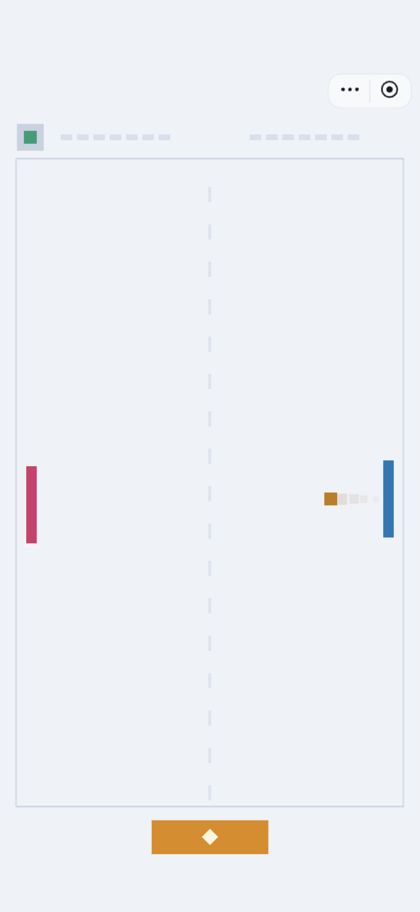

# Bevy Pong × 抖音小游戏

一个竖屏 Pong，用 Bevy 0.20 写成，通过
[bevy-douyin-adapter](https://gitee.com/pppkin/bevy_douyin) 跑进抖音小游戏。

它是一份配套示例。照着它走一遍，就能把同样的步骤搬到你的游戏里：画布尺寸、
安全区、胶囊避让、指针换算、主题、激励视频、存档和真机排错。

| 深色主题 | 浅色主题 |
| --- | --- |
|  |  |

截图来自抖音开发者工具模拟器，画布为 720×1561。真机尺寸通常不同，游戏会自动适配。

## 安装

### 1. 克隆仓库

```bash
git clone --recurse-submodules https://gitee.com/pppkin/bevy_douyin_example.git
cd bevy_douyin_example
```

如果已经克隆过，补上 submodule：

```bash
git submodule update --init --recursive
```

### 2. 安装工具

| 工具 | 要求 |
| --- | --- |
| Rust | stable；`rust-toolchain.toml` 会自动装 wasm32 目标 |
| `wasm-bindgen` CLI | 必须 0.2.129，和 `Cargo.toml` 一致 |
| `wasm-opt` | Binaryen，实测 133 |
| `brotli` | 生成 `.wasm.br` |
| `python3` | 运行 glue 补丁 |
| `esbuild` | 可选；有就压缩 JS |
| 抖音开发者工具 | 导入 `platforms/douyin/package/` |

```bash
rustup target add wasm32-unknown-unknown
cargo install wasm-bindgen-cli --version 0.2.129 --locked
brew install binaryen brotli
brew install esbuild        # 可选
```

### 3. 构建

```bash
./build.sh
```

首次约 3 分钟，之后增量约 1 到 2 分钟。构建完成后，`platforms/douyin/package/`
里应该有：

```text
game.js              手写入口，提交
game.json            手写配置，提交
project.config.json  手写工程配置，提交
pong.js              wasm-bindgen glue，构建产物
pong.wasm.br         Brotli 压缩的 wasm，构建产物
runtime/             adapter.js + bootstrap.js
assets/              有 assets/ 时才出现
```

### 4. 导入开发者工具

1. 打开抖音开发者工具，登录小游戏账号。
2. 导入 `platforms/douyin/package/`。不要导入仓库根目录，也不要导入 `platforms/douyin/`。
3. 把 `project.config.json` 里的 `appid` 换成自己的 AppID。示例里的
   `tt0000000000000000` 只能跑模拟器。
4. 点“编译”。

## 使用示例

| 操作 | 效果 |
| --- | --- |
| 按住屏幕上下拖动，或移动鼠标 | 控制右侧球拍 |
| `↑` `↓` 或 `W` `S` | 用键盘控制右侧球拍 |
| 点击左上角方块 | 切换深色 / 浅色主题，并写入存档 |
| 点击底部黄色胶囊 | 请求激励视频；无广告位时走适配层 mock，获得 8 秒慢动作 |
| 静止 1.5 秒 | 球拍自动跟球，方便挂机观察 |

先到 7 分者赢一局，胜场会累计。顶部中央的菱形在追平或刷新最高连续对拉时点亮。

## 功能特性

- **竖屏自适应**：设计分辨率 720×1280，实际高度按屏幕比例推导，画面不拉伸。
- **安全区与胶囊避让**：同时读取 `SafeArea.top` 和 `menuButton.bottom`，计分条不会压到右上角胶囊。
- **三种输入**：触摸、模拟器鼠标、键盘。触摸和合成鼠标事件会去重，一次点击只触发一次。
- **主题**：启动读取系统主题；未手动选择时每 4 秒跟随。手动切换后由适配层固定，并写入存档。
- **激励视频**：用 `RequestAd` 拿 ticket，用 `AdResult` 对账；空广告位走 600ms mock，换真实广告位不用改 Rust。
- **纯 Sprite + 内嵌音效**：没有图片和字体，分数用计分块表示；三段 WAV 用
  `include_bytes!` 编进 wasm，不依赖资源服务器。
- **原生音频**：`bevy_audio` 经 `rodio → cpal → WebAudio` 输出，碰球、撞墙、得分
  各有音效；切后台自动 suspend。
- **本地存档**：最高对拉、双方胜场、主题都走适配层存储，并用 `storagePrefix` 隔离。
- **设备诊断**：设 `GameGlobal.__probe = 1` 可看诊断日志；panic 时会弹 `tt.showModal`。

## 配置说明

### `platforms/douyin/package/game.js`

| 字段 | 当前值 | 说明 |
| --- | --- | --- |
| `name` | `pong` | 日志前缀 |
| `canvas` | `#pong-canvas` | 画布选择器 |
| `width` / `height` | `720` / `1280` | 设计分辨率 |
| `wasm` | `pong.wasm.br` | wasm 产物 |
| `glue` | `require('./pong.js')` | 延迟加载 glue |
| `adUnitId` | 空 | 留空时用适配层 mock |
| `globalPrefix` | `__bevy_douyin_` | 必须和 `host.rs` 一致 |
| `storagePrefix` | `pong.` | 存档命名空间 |

### 构建参数

`build.sh` 只是把目录布局翻译成适配层参数，额外参数会原样透传：

```bash
./build.sh --no-minify
INITIAL_MEMORY_BYTES=$((32*1024*1024)) ./build.sh
```

### 想改什么，去哪里

| 目标 | 文件 |
| --- | --- |
| 分辨率、速度、AI、分数 | `platforms/douyin/src/game.rs` 顶部常量 |
| 新的宿主能力，如分享、震动 | `platforms/douyin/src/host.rs` |
| 广告位、canvas id、存档前缀 | `platforms/douyin/package/game.js` |
| 构建参数、初始内存 | 根目录 `build.sh` 或环境变量 |
| Bevy 特性与包体积 | `platforms/douyin/Cargo.toml` 的 `features` |

### 存档键

| Rust key | 实际 key | 内容 |
| --- | --- | --- |
| `best_rally` | `pong.best_rally` | 最高连续对拉 |
| `wins.ai` | `pong.wins.ai` | AI 胜场 |
| `wins.player` | `pong.wins.player` | 玩家胜场 |
| `theme` | `pong.theme` | `dark` / `light` |

### 音效

音效在 `assets/audio/`：`hit.wav`（碰球）、`wall.wav`（撞墙）、`score.wav`
（得分）。构建时不会把它们复制进小游戏包，而是在 `game.rs` 里直接
`include_bytes!` 进 wasm。换音效时保持 44.1kHz 单声道 16-bit PCM，体积最小。

要加背景音乐，建议用远程 URL 或 `tt.createInnerAudioContext`；抖音包内文件
不能用 `fetch` 读取。

## 目录结构

```text
.
├── addons/bevy-douyin/      适配层 submodule（tag adapter-v0.4.0）
├── build.sh                 构建入口
├── docs/
│   ├── adapter-contract.md  适配层契约
│   ├── code-tour.md         代码结构与可调参数
│   ├── device-checklist.md  从零到真机的检查清单
│   └── troubleshooting.md   症状、原因、处理
└── platforms/douyin/
    ├── Cargo.toml
    ├── src/
    │   ├── main.rs          窗口、相机、渲染容错
    │   ├── host.rs          读宿主全局，封装广告与存储
    │   ├── game.rs          玩法与表现
    │   └── probe.rs         诊断与 panic 弹窗
    └── package/             导入开发者工具的目录
```

## 它是怎么跑起来的

```text
game.js
  └─ require('./runtime/bootstrap.js')
       ├─ adapter.install(...)          装 window / WebGL2 / 输入 / 存储 shim
       │                                发布 Layout / Theme / RequestAd 等全局
       └─ require('./pong.js')          加载补过的 wasm glue
            └─ Bevy 启动，host.rs 读全局，建窗口，跑游戏
```

关键顺序：**先装 shim，再加载 wasm glue**。否则 winit 拿不到 `window`、WebGL2
上下文和输入事件。`bootstrap.js` 已经处理好顺序，业务代码不要提前 `require`
`pong.js`。

更完整的契约见 [docs/adapter-contract.md](docs/adapter-contract.md)。

## FAQ / 故障排查

**模拟器黑屏，或只亮一帧？**
先看 `RenderErrorHandler`、`Msaa::Off` 和 `CompositeAlphaMode::Opaque` 三处。示例已经配好；改启动代码时不要删。

**构建报 `patch_glue.py` 找不到字符串？**
把 `wasm-bindgen` crate 和 CLI 都固定到 0.2.129。

**导入后提示 AppID 无效？**
把 `project.config.json` 的 `appid` 换成自己的。`tt0000000000000000` 只能用于模拟器。

**点广告没反应？**
看控制台是否出现 `ad mock ... ticket=1`。没有日志时，先确认点击命中了底部胶囊；有日志但没有奖励时，检查 `AdResult` 的 `ticket` 是否和请求一致。

**点击位置和画面对不上？**
`SafeArea` 是 CSS px，`Canvas` 和指针是画布 px，世界坐标以中心为原点。三种单位不要混用。

**真机和模拟器表现不同？**
按 [docs/device-checklist.md](docs/device-checklist.md) 逐项检查，尤其是胶囊、安全区和真实广告位。

更多症状见 [docs/troubleshooting.md](docs/troubleshooting.md)。

## 贡献指南

- 适配层的问题提到 [bevy_douyin](https://gitee.com/pppkin/bevy_douyin)；示例玩法的问题提到本仓库。
- 改适配层后运行 `npm test`，并补一条对应测试。
- 改示例后运行 `cargo check --manifest-path platforms/douyin/Cargo.toml` 和 `./build.sh`。
- 接口变化时同步更新 `docs/adapter-contract.md` 和适配层的 `CHANGELOG.md`。

## 许可证

本仓库没有单独放 `LICENSE` 文件。示例代码沿用适配层的 WTFPL 许可证，见
[addons/bevy-douyin/LICENSE](addons/bevy-douyin/LICENSE)。
