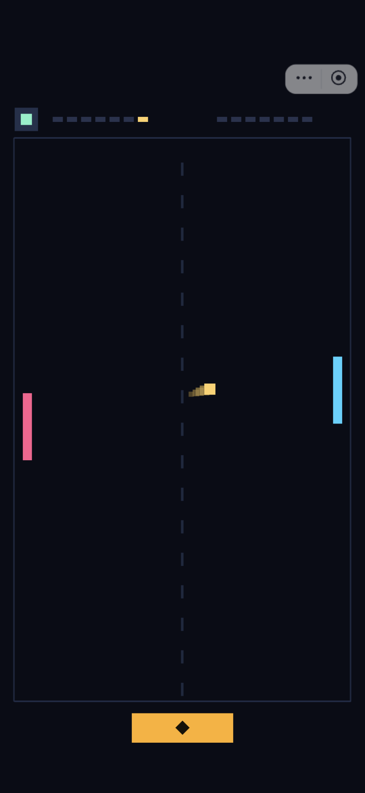

# Bevy Pong × 抖音小游戏

一个用 [Bevy 0.20](https://bevyengine.org) 写的竖屏 Pong，跑在抖音小游戏里。
平台适配层（WebGL2 / DOM shim / 触摸 / 广告 / 存储）不在本仓库里，而是以 git
submodule 的形式引入：

```
addons/bevy-douyin  →  https://gitee.com/pppkin/bevy_douyin  (tag: adapter-v0.3.0)
```

本仓库是适配层的**配套示例**：它刻意保持小，但把"从零把一个 Bevy 游戏接到抖音"
需要的每一步都走了一遍，包括画布尺寸、安全区、胶囊避让、指针换算、主题、激励视频、
存档和真机排错。文档比代码多，是故意的。

| 深色主题 | 浅色主题 |
| --- | --- |
|  |  |

> 截图来自抖音开发者工具模拟器（720×1561 画布，右上角胶囊由模拟器绘制）。
> 真机上的画布尺寸、安全区通常不同，游戏会自动适配。

---

## 特性

- **竖屏、自适应高度**：设计分辨率 720×1280，实际画布高度按设备宽高比推导
  （模拟器上是 720×1561），游戏区域不会被拉伸。
- **安全区 + 胶囊避让**：同时使用 `SafeArea.top` 和 `SafeArea.menuButton.bottom`，
  计分条永远在右上角胶囊下方。
- **三种输入**：触摸拖动、模拟器鼠标、键盘 `↑/↓`（或 `W/S`）。触摸与合成鼠标
  事件会去重，一次点击只触发一次。
- **主题**：启动读取系统主题，未手动选择时每 4 秒跟随；左上角按钮切换后由适配层
  记为手动值（`ThemeManual`），不会又被系统改回去，并写入存档。
- **激励视频**：底部胶囊是广告入口。没有配置广告位时由适配层内置 mock 返回
  `loading → ended`（默认 600ms，可用 `mockAdDelay` 调整），配置真实 `adUnitId`
  后同一套代码走真实激励视频，Rust 侧不用改。0.3 起 `RequestAd` 返回 ticket，
  `AdResult` 回传同一张 ticket，适配层还会在 30 秒无终态时主动报 `timeout`；
  游戏保留 `RequestAd() == 0` 时的 0.9 秒本地兜底（例如 `mockAds: false`）。
- **纯 Sprite，零资源**：没有图片、字体、音频；分数用 7 个计分块表示，产物只有
  wasm + JS。
- **本地存档**：最高连续对拉、双方胜场、主题，走适配层的 `localStorage`
  （底层是 `tt.setStorageSync`），并用 `storagePrefix: 'pong.'` 做命名空间，
  重开小游戏仍在。
- **设备诊断**：`GameGlobal.__probe = 1` 时输出每帧/低频诊断日志，panic 弹
  `tt.showModal`（真机 `panic = "abort"` 时控制台经常什么都看不到）。

## 环境要求

| 工具 | 版本 / 说明 |
| --- | --- |
| Rust | stable（本仓库 `rust-toolchain.toml` 会自动装 `wasm32-unknown-unknown`） |
| wasm-bindgen CLI | **必须 0.2.129**（要和 `Cargo.toml` 里的 `wasm-bindgen` 完全一致） |
| wasm-opt | Binaryen（Homebrew `binaryen`，实测 133） |
| brotli | CLI（Homebrew `brotli`） |
| python3 | 适配层的 glue 补丁脚本用 |
| esbuild | 可选；有则压缩 `pong.js`，没有也能构建 |
| 抖音开发者工具 | 导入 `platforms/douyin/package/` |

macOS 一次装齐：

```bash
rustup target add wasm32-unknown-unknown
cargo install wasm-bindgen-cli --version 0.2.129 --locked
brew install binaryen brotli
# 可选
brew install esbuild
```

> 版本不匹配是这套流程最常见的失败原因：`wasm-bindgen` crate、CLI 必须同为
> 0.2.129，否则生成的 glue 结构和 `tools/patch_glue.py` 的匹配规则对不上。

## 快速开始

```bash
# 1. 连同 submodule 一起克隆（已克隆的话执行 git submodule update --init --recursive）
git clone --recurse-submodules <本仓库地址>
cd bevy_douyin_example

# 2. 构建（首次约 3 分钟，之后增量约 1~2 分钟）
./build.sh

# 3. 用抖音开发者工具导入这个目录（不是仓库根目录）：
#    platforms/douyin/package/
```

`./build.sh` 只是把本仓库的目录布局翻译成适配层构建脚本的参数：

```bash
addons/bevy-douyin/tools/build.sh \
  --crate platforms/douyin \
  --out   platforms/douyin/package \
  --name  pong \
  --wasm  pong_douyin
```

额外参数会原样透传，例如 `./build.sh --no-minify`，或者用环境变量调整初始内存：

```bash
INITIAL_MEMORY_BYTES=$((32*1024*1024)) ./build.sh
```

构建完成后 `platforms/douyin/package/` 里应该有：

```
game.js              手写入口（提交）
game.json            手写配置（提交）
project.config.json  手写工程配置（提交）
pong.js              wasm-bindgen glue（构建产物，已 gitignore）
pong.wasm.br         Brotli 压缩的 wasm（构建产物，已 gitignore）
runtime/             从适配层拷贝的 adapter.js + bootstrap.js（构建产物）
assets/              有 assets/ 目录时才会出现
```

> 导入开发者工具前，把 `project.config.json` 里的 `appid` 换成你自己的小游戏
> AppID；示例里的 `tt0000000000000000` 只能用于本地模拟器。

## 操作

| 操作 | 效果 |
| --- | --- |
| 按住屏幕上下拖动 / 移动鼠标 | 控制右侧球拍 |
| `↑` `↓` / `W` `S` | 键盘控制右侧球拍 |
| 点击左上角方块 | 切换深色 / 浅色主题（会存档） |
| 点击底部黄色胶囊 | 请求激励视频；无广告位时走适配层 mock，获得 8 秒慢动作 |
| 静止 1.5 秒 | 球拍自动跟随球（方便模拟器里挂机观察） |

先到 7 分者赢一局，胜场会累计；顶部中央的菱形在追平或刷新最高连续对拉时点亮。

## 目录结构

```
.
├── addons/bevy-douyin/          适配层 submodule（tag adapter-v0.3.0）
├── build.sh                     构建入口（参数翻译 + 透传）
├── rust-toolchain.toml          stable + wasm32 target
├── docs/
│   ├── adapter-contract.md      适配层到底承诺了什么（画布/安全区/指针/主题/广告/存储）
│   ├── code-tour.md             这个示例的代码结构、系统顺序、可调参数
│   ├── device-checklist.md      从零到真机的完整检查清单
│   └── troubleshooting.md       症状 → 原因 → 处理
└── platforms/douyin/
    ├── Cargo.toml               薄壳 crate（package name: pong_douyin）
    ├── src/
    │   ├── main.rs              窗口 / 相机 / 渲染容错 / 启动
    │   ├── host.rs              读适配层全局：尺寸、安全区、主题、广告、存储
    │   ├── game.rs              全部玩法与表现
    │   └── probe.rs             probe 开关、panic 弹窗、内存诊断
    └── package/                 抖音工程目录（导入开发者工具的就是它）
        ├── game.js              入口：runtime.start(...)
        ├── game.json            竖屏、隐藏状态栏
        └── project.config.json  appid / es6 等
```

## 它是怎么跑起来的

```
game.js
  └─ require('./runtime/bootstrap.js')
       ├─ adapter.install({ canvas, width, height, globalPrefix, storagePrefix, adUnitId })
       │    ├─ 创建 tt.createCanvas()，按屏幕比例推导画布尺寸
       │    ├─ 安装 window / document / WebGL2 / 输入 / 存储 / 主题 shim
       │    └─ 发布 Version / Config / Layout / ViewportSeq / Theme /
       │       ThemeManual / RequestAd / AdResult / AppState
       └─ require('./pong.js')          ← wasm-bindgen 生成、被 patch_glue.py 改过
            └─ TTWebAssembly.instantiate(解压后的 wasm)
                 └─ Bevy 启动，host.rs 读全局 → 建窗口 → 跑游戏
```

关键点：**shim 必须在 wasm glue 之前安装**。否则 winit 拿不到 `window`、WebGL2
上下文和输入事件。`bootstrap.js` 已经保证了顺序，业务代码不要自己提前 `require`
`pong.js`。

更完整的契约见 [docs/adapter-contract.md](docs/adapter-contract.md)。

## 我改这个示例时该看哪里

| 想改什么 | 去哪里 |
| --- | --- |
| 分辨率、玩法、速度、AI、分数 | `platforms/douyin/src/game.rs`（顶部常量 + `Field::from_view`） |
| 读取新的宿主能力（如分享、震动） | `platforms/douyin/src/host.rs`，并对照适配层的全局命名 |
| 广告位、入口文案、canvas id | `platforms/douyin/package/game.js` |
| 构建参数、初始内存 | 根目录 `build.sh`（透传）或环境变量 |
| Bevy 特性裁剪 / 包体积 | `platforms/douyin/Cargo.toml` 的 `features` |

## 已知限制

- 只有竖屏；`game.json` 写死 `"deviceOrientation": "portrait"`。
- 没有音频、文字和图片资源，音效/字体需要自己加 `bevy_audio` 等特性。
- 示例的 `adUnitId` 为空，广告由适配层 mock；真广告位需要在抖音后台创建激励视频广告位。
- 只在抖音开发者工具模拟器完整验证过；真机差异与检查项见
  [docs/device-checklist.md](docs/device-checklist.md)。
- 适配层固定在 `adapter-v0.3.0`。升级 submodule 后要重新跑一遍设备检查清单。
